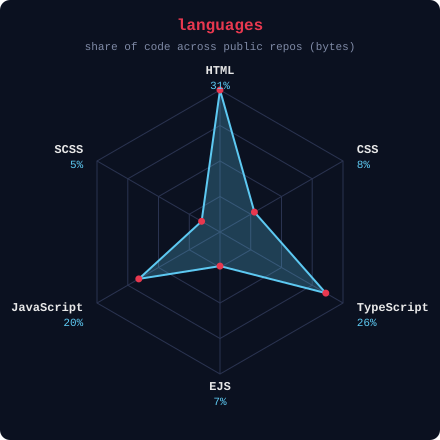
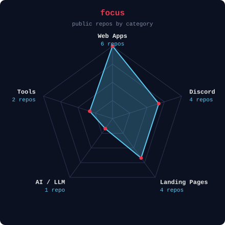

## `$ whoami`

---

## `$ cat tech-stack.yaml`

| `hymndavinci:~$ cat tech-stack.yaml` | |
| --- | --- |
| `├─ ⌨ languages:`   `TypeScript · JavaScript · Python` | `├─ ▣ web:`   `Next.js · React · Tailwind CSS · Astro` |
| `├─ ⚙ backend:`   `Node.js · discord.js` | `├─ ▣ databases:`   `PostgreSQL · Prisma · SQLite` |
| `├─ ☁ deploy_ops:`   `Vercel · Linux · Docker · GitHub Actions · Pterodactyl` | `╰─ ◉ tools:`   `Git · VS Code` |
| `status: ready · environment: production` | |

---

## `$ fastfetch`

`signals: language_radar · focus_radar · status: healthy`

---

## `$ connect --socials`

Dibuat dengan 💖 dan banyak kopi dari Purbalingga, Indonesia · @hymndavinci

<!-- Card generated by scripts/generate_card.py (ascii-profile-card template, MIT) + scripts/generate_radars.py — stats refresh daily via GitHub Actions. -->
